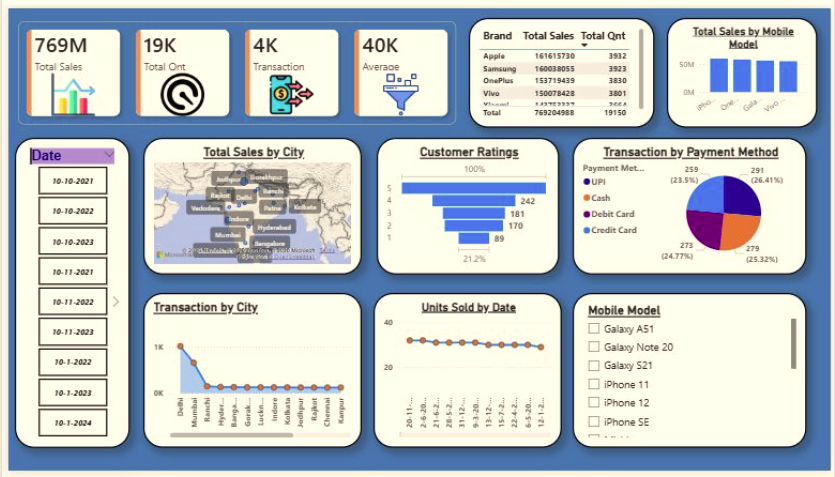

# 📱 Mobile Sales Analysis Dashboard (Power BI)

An interactive **Power BI dashboard** that analyzes mobile phone sales across brands, models, cities, payment methods, and time. It helps answer questions like *which brand sells the most, which cities drive revenue, and how do customers pay and rate their purchases?*



---

## 📌 Project Overview

| Item | Details |
|------|---------|
| **Tool** | Microsoft Power BI Desktop |
| **Domain** | Retail / Mobile Phone Sales |
| **Goal** | Turn raw sales data into clear, interactive insights |
| **Dataset** | Mobile sales data (brand, model, city, date, payment method, rating) |

---

## 🎯 Objectives

- Track overall sales performance with headline KPIs
- Compare sales and quantity across **brands** and **mobile models**
- Identify top-performing **cities**
- Understand **payment method** preferences
- Analyze **customer ratings** distribution
- Monitor **units sold over time**
- Let users filter everything interactively by **date** and **mobile model**

---

## 📊 Dashboard Components

### KPI Cards
| Metric | Value |
|--------|-------|
| Total Sales | **769M** |
| Total Quantity | **19K** |
| Transactions | **4K** |
| Average | **40K** |

### Visuals
- **Brand Table** – Total sales and total quantity by brand (Apple, Samsung, OnePlus, Vivo, Xiaomi)
- **Total Sales by Mobile Model** – Bar chart comparing revenue across models
- **Total Sales by City** – Map showing sales distribution across Indian cities
- **Customer Ratings** – Funnel chart of ratings from 1 to 5
- **Transaction by Payment Method** – Pie chart (UPI, Cash, Debit Card, Credit Card)
- **Transaction by City** – Area chart ranking cities by transaction count
- **Units Sold by Date** – Line chart showing the sales trend over time

### Slicers (Filters)
- **Date** slicer
- **Mobile Model** slicer (Galaxy A51, Galaxy Note 20, Galaxy S21, iPhone 11, iPhone 12, iPhone SE, …)

---

## 🔍 Key Insights

- **Apple leads in sales** (~161.6M), followed closely by **Samsung** (~160.0M), **OnePlus** (~153.7M), and **Vivo** (~150.1M), so the market is fairly evenly split across brands.
- **Payment methods are evenly distributed**: UPI (26.41%), Cash (25.32%), Debit Card (24.77%), and Credit Card (23.5%).
- **Delhi has the highest number of transactions**, with a sharp drop-off for other cities.
- **Units sold per day stay relatively steady** across the period, with no major spikes or dips.
- Customer ratings are reviewed on a 1–5 scale, with the lowest rating (1 star) being the smallest group.

---

## 🛠️ Skills & Concepts Used

- Data cleaning and transformation in **Power Query**
- Data modeling and relationships
- **DAX** measures (Total Sales, Total Quantity, Transactions, Average)
- Interactive visuals, slicers, and cross-filtering
- Dashboard layout and design
- Map, funnel, pie, line, bar, and area charts

---

## 📁 Repository Structure

```
├── dashboard.png.png       # Dashboard screenshot
├── MobileSales.pbix        # Power BI dashboard file
├── data/
│   └── mobile_sales.csv    # Dataset
└── README.md
```

> Update the file names above to match your actual files.

---

## 🚀 How to Use

1. Clone this repository
   ```bash
   git clone https://github.com/BhartiSaini7/Mobile-Sales-Dashboard-PowerBI.git
   ```
2. Install [Power BI Desktop](https://powerbi.microsoft.com/desktop/) (free, Windows)
3. Open the `.pbix` file
4. If prompted, refresh the data source so it points to `data/mobile_sales.csv`
5. Use the **Date** and **Mobile Model** slicers to explore the data

---

## 📈 Possible Improvements

- Add profit and margin analysis
- Add year-over-year and month-over-month comparisons
- Include customer segmentation
- Add drill-through pages for brand and city details
- Publish to Power BI Service for online sharing

---

## 👤 Author

**Bharti Saini**
- GitHub: [@BhartiSaini7](https://github.com/BhartiSaini7)
- LinkedIn: [Bharti Saini](https://www.linkedin.com/in/bharti-saini-a318bb2b2)

---

## 🙏 Acknowledgments

Created as part of a data analytics course project. Thanks to the course instructors and community for guidance.

---

⭐ If you found this project helpful, please consider giving it a star!
